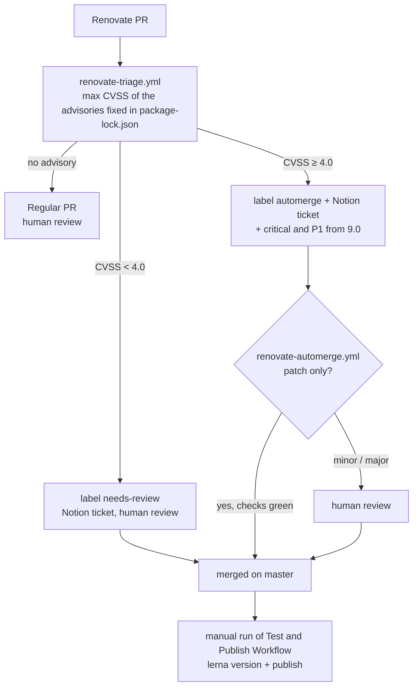

# Dependency updates (Renovate)

Dependencies are kept up to date by the hosted [Mend Renovate](https://developer.mend.io/github/algoan/nestjs-components)
app, configured in [`renovate.json`](../renovate.json). It replaces the Dependabot version updates;
Dependabot alerts stay on. Security fixes are routed by the CVSS of the vulnerabilities they fix,
with the shared actions of [`algoan/private-actions`](https://github.com/algoan/private-actions/tree/beta/renovate-security)
(`renovate-security`), the same flow as `algoan/backend`. The **hotfix flow is off**: nothing is
deployed from this repository.

## What happens after a merge

A merge on `master` runs no release. The packages reach npmjs.com and GitHub Packages only when
someone runs **Test and Publish Workflow** manually on `master` (`lerna version` with conventional
commits, then `lerna publish from-git`). Renovate's commits follow the conventional format
(`:semanticCommits`): `fix(deps): …` for the `dependencies` of a package gives it a patch release,
`chore(deps): …` (root dev dependencies, lockfile) releases nothing.

So a security fix in the runtime `dependencies` of a package (`lodash`, `flatted`, `jwt-decode`…)
reaches consumers at the next release: run the publish workflow once it is merged. A fix that only
moves `package-lock.json` changes nothing for consumers, who resolve their own lockfile.

## What Renovate updates

| Manager          | Files                                                                   |
| ---------------- | ----------------------------------------------------------------------- |
| `npm`            | the root `package.json`, `packages/*/package.json`, `package-lock.json` |
| `github-actions` | `.github/workflows/*.yml`                                               |
| regex            | the `algoan/private-actions` checkout of the `renovate-*.yml` workflows |

Routine updates are grouped into one weekly PR (Monday before 6am, Europe/Paris); majors come on
the same schedule, one PR each. A new npm version is only proposed once it is 3 days old
(`security:minimumReleaseAgeNpm`), and `minimumReleaseAgePackageManagerSync` gives npm the same
wait, so the weekly lockfile maintenance skips younger transitive versions too. Our `@algoan`
packages (`@algoan/pubsub`, `@algoan/eslint-config`) don't wait. Lockfile maintenance runs weekly
too.

`algoan/private-actions` updates come in their own weekly PR (`algoan private-actions`), for a human
review: it runs the triage and the automerge.

Security PRs are opened immediately at the **lowest fixing version**
(`vulnerabilityFixStrategy: lowest`), without the release-age wait. They keep the range of the
dependency and raise its floor (`rangeStrategy: bump`, e.g. `^4.17.21` → `^4.18.1`) instead of
pinning it: the packages are libraries, an exact version would be forced on every consumer.

Not scored by the triage:

- GitHub Actions advisories: such a security PR gets `needs-review` and a ticket at CVSS unknown;
- packages left unscored by a GitHub API rate limit: the triage comment lists them with the reset
  time, and the automerge doesn't merge the PR. Re-run the triage after that time.

## Routing

- **`renovate-triage.yml`** (`pull_request_target`) scores the packages changed in
  `package-lock.json` with the GitHub Advisory Database. The highest CVSS decides the tier. For a
  security PR it creates or updates a `Vulnerability` ticket in Notion, sets the `security` label
  plus `automerge` or `needs-review` (and `critical` from 9.0), and comments the advisories with the
  ticket (`[ALG-NNNN]`). The PR title stays Renovate's: Renovate rewrites it, and recognises a PR
  closed on purpose by its exact title. The triage runs again when Renovate pushes to the PR or adds
  the `security` label. It only runs for PRs opened by `renovate[bot]`, from the base commit:
  nothing from the PR runs with the secrets, which matters on this public repository.
- **`renovate-automerge.yml`** merges PRs labelled `automerge` with a merge commit, like the other
  PRs here, as the `algoan-merger` GitHub App (bypass actor of the branch ruleset). It recomputes
  the tier for the head commit, requires every commit to be authored by Renovate and signed by
  GitHub, and only accepts changes to dependency files. Only **patch** bumps merge automatically;
  minor/major wait for a human. Every check of the head commit must be green, and these must be
  present: `Tests` and `Socket Security: Pull Request Alerts`. The triage starts it, and it runs
  again when the test workflow completes; each run waits up to 8 minutes for the checks still
  running (Socket and CodeRabbit can end after the test workflow, and their end starts no new run),
  then starts a new run if some still are, three times at most. It never merges a PR with a change
  request or an unresolved thread.
- **Critical fixes (CVSS ≥ 9.0)** take the same path with the `critical` label and a P1 ticket:
  release the affected packages quickly once merged.

`Tests` is a job of `test-and-publish.yaml` that sums up the Node.js matrix: the matrix job names
(`test (22.x, 10)`) change with the versions and contain a comma, which `required_checks` can't hold.

## Configuration

| Repository variable         | Default                                      | Notes                               |
| --------------------------- | -------------------------------------------- | ----------------------------------- |
| `CVSS_AUTOMERGE_THRESHOLD`  | `4.0`                                        |                                     |
| `CVSS_HOTFIX_THRESHOLD`     | `9.0`                                        | Unused while the hotfix flow is off |
| `AUTOMERGE_REQUIRED_CHECKS` | `Tests,Socket Security: Pull Request Alerts` | Comma-separated check names         |
| `NOTION_SUB_TECH_TEAM`      | `Back`                                       | Sub-tech-team of the Notion tickets |

Org secrets used: `REPO_GHA_PAT`, `ALGOAN_MERGER_APP_ID`, `ALGOAN_MERGER_PRIVATE_KEY`,
`NOTION_TOKEN`. A public repository can't call the actions of the private `algoan/private-actions`
with `uses:`, so the workflows check them out with `REPO_GHA_PAT`, at a commit pinned with its tag
in a comment, which a regex manager of `renovate.json` keeps up to date.

Repository settings: Renovate and `algoan-merger` apps installed, Dependabot alerts on, merge
commits allowed (the automerge merges like the other PRs), and `algoan-merger` as bypass actor of
the branch ruleset in _pull requests only_ mode. The ruleset requires no approval and no status
check: the automerge waits for its own list of checks. _Allow GitHub Actions to create and approve
pull requests_ isn't needed.
